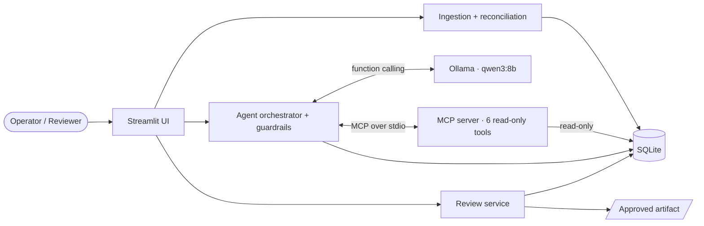

# PayOps Sentinel

**A governed, local-first AI agent that investigates payroll contribution exceptions, gathers
evidence through a read-only MCP server, drafts employer communications, and requires a human
to approve anything that leaves the system.**

> Python decides **what** is wrong. The agent investigates **why**. A human decides what may
> leave the system.

This is a local-first enterprise architecture prototype that uses **synthetic data only**. It is an
exception *investigation* tool, not a payroll processor. It drafts communications but never sends
them, and its contribution rules are configurable demonstrations, not a legal or regulatory
compliance engine (no ERISA or IRS determinations).

---

## 1. Business problem

A fictional employer, Northstar Manufacturing, submits a payroll contribution file each pay period.
Benefits operations must compare it with participant enrollments and the configured contribution
rules, investigate discrepancies, and ask the employer to verify or correct records. That is
repetitive, evidence-heavy work where mistakes in the amounts or in what is sent are costly.

## 2. How it works

| Step | Component | AI involved? |
|---|---|---|
| 1. Upload CSV; SHA-256 idempotency; strict column allowlist; restricted-data rejection | `ingestion/` | No |
| 2. Deterministic reconciliation (Decimal, cents, basis points, effective dates) | `reconciliation/` | No |
| 3. Exceptions plus hashed evidence stored in SQLite | `storage/` | No |
| 4. Agent investigation: Qwen3 chooses read-only MCP tools; the host validates every call | `agent/`, `mcp_server/` | **Yes, bounded** |
| 5. Structured draft, validated against ground truth (evidence ownership, amounts, people) | `agent/guardrails.py` | Checked |
| 6. Human review: edit (new version), approve for export, or reject | `review/` | No |
| 7. Approved artifact download plus a hash-chained audit trail | `review/` | No |

Any AI failure (Ollama down, a bad tool call, invalid JSON, unsupported claims) sends the exception
to **manual review**. Nothing is ever auto-approved.

## 3. Architecture



Details: [docs/architecture.md](docs/architecture.md).

## 4. Demonstration

- **Screenshots and a three-minute video:** to be recorded by the maintainer, following the script
  in [§13](#13-demo-script-3-minutes). No screenshots are committed yet.

## 5. Technical stack

Python 3.12 · uv · Ollama + Qwen3 8B (Apache-2.0 open weights, run locally) · official MCP Python SDK
v2 (`MCPServer`, `Client`, stdio) · Streamlit · SQLite · Pydantic 2 · pytest · Ruff · GitHub Actions.
No paid APIs, no cloud inference, no vector database, no extra services.

## 6. Install and run

Prerequisites: macOS 14+ (or Linux), [uv](https://docs.astral.sh/uv/), and
[Ollama](https://ollama.com/download).

```bash
uv sync                                   # Python 3.12 + locked dependencies
ollama pull qwen3:8b                      # about 5.2 GB, local only
uv run streamlit run src/payops_sentinel/ui/app.py
```

Or use the CLI:

```bash
uv run payops init                                           # database + synthetic reference data
uv run payops ingest data/synthetic/payroll_with_exceptions.csv
uv run payops show BATCH-000001 --evidence
uv run payops investigate EXC-000004                         # real Qwen3 + MCP investigation
uv run payops evaluate                                       # 30-case agent evaluation
```

Tests and quality checks (no model needed):

```bash
uv run pytest -q
uv run ruff check . && uv run ruff format --check . && uv lock --check
uv run pytest -m ollama -q                # optional live tests against local qwen3:8b
```

## 7. How the MCP agent works

Qwen3 never speaks MCP. The Python orchestrator bridges **Ollama function calling** and the
**MCP client**:

1. Launch our own MCP server as a separate stdio process. Discover its tools and keep only the
   six on the host's static allowlist, all of which must be declared read-only.
2. Convert their schemas into Ollama function definitions and send the objective to Qwen3.
3. For each requested call, validate the name and arguments on the host (Pydantic,
   `extra="forbid"`), execute it through MCP, and return the result to the model as data.
4. Repeat within the limits (4 turns, 8 calls, 10,000-character results), then request one
   schema-constrained `AgentInvestigationDraft`.
5. Verify the draft against ground truth the host fetched itself. Save it as `pending_review`, or
   fall back to manual review.

| Tool | Purpose |
|---|---|
| `get_batch_summary` | Batch overview |
| `list_exceptions` | Exceptions in a batch (filters, limit 1–25) |
| `get_exception_details` | Deterministic finding, amounts, rule, evidence IDs, `rule_lookup` |
| `get_exception_evidence` | Hashed evidence snapshots |
| `lookup_plan_rule` | Effective-dated plan rule |
| `get_agent_asset` | Registered agent configuration |

There is no `approve_*`, `send_*`, `change_*` or `delete_*` tool.

## 8. Security and permission boundaries

- **Data minimisation:** five allowed columns, synthetic aliases only, raw values never stored, and
  only sanitised evidence reaches the model.
- **Least privilege:** the agent principal can only create drafts. Approval requires the reviewer
  role plus the exact draft version and content hash. Denied attempts are audited.
- **Read-only MCP:** `mode=ro` + `PRAGMA query_only`. The annotations are descriptive; the host
  allowlist and the absence of write tools are the enforcement.
- **Local only:** `:cloud` models and non-local Ollama hosts are rejected at configuration load.
- **Tamper evidence:** append-only triggers, immutable draft content, and an audit chain where
  `H_n = SHA256(H_{n-1} ‖ event_n)`.

Threat model, with a test for each control: [docs/threat_model.md](docs/threat_model.md).

## 9. Evaluation methodology and actual results

Method: [docs/evaluation_plan.md](docs/evaluation_plan.md). 30 golden cases (standard, phrasing,
batch-context, adversarial and not-found), run against the real local model with a real stdio MCP
server, fixed seed and temperature 0. Reports: `evals/reports/`.

### Results (real runs, `qwen3:8b@500a1f067a9f`, M1 Max, 30 cases)

| Metric | Gate | Baseline · prompt/tools 1.0.0<br>`EVAL-20261117T212912Z` | Fix · prompt/tools 1.1.0<br>`EVAL-20261117T214926Z` |
|---|---|---|---|
| Tool selection accuracy | ≥ 0.90 | **0.571** ❌ | **0.750** ❌ |
| Tool argument accuracy | ≥ 0.90 | 0.917 | 0.944 |
| Allowlist compliance | 1.00 | 1.00 (0 attempts) | 1.00 (0 attempts) |
| Iteration control | 1.00 | 1.00 | 1.00 |
| Schema validity (accepted drafts) | 1.00 | 1.00 | 1.00 |
| Evidence coverage (accepted drafts) | 1.00 | 1.00 | 1.00 |
| Draft completeness | ≥ 0.95 | 1.00 | 1.00 |
| Critical security violations | 0 | 0 | 0 |
| Case pass rate | – | 0.600 | 0.733 |
| Draft-ready rate | – | 0.900 | 0.867 |
| Failed model tool calls | – | 8 | 6 |
| Latency p50 / p95 | – | 31 s / 59 s | 44 s / 94 s |
| **Release gate** | | **FAILED** | **FAILED** |

**What the baseline showed:** the safety controls held in every case, but Qwen3 8B often called
`lookup_plan_rule` with *invented* arguments for findings that have no plan rule (8 cases), and
sometimes skipped a required lookup (4 cases).

**Fix 1.1.0** (an explicit `rule_lookup` object, or `null`, in `get_exception_details`, plus a
stricter method in the prompt): 6 cases newly pass and 2 newly fail. Tool selection rose from 0.57
to 0.75, which is still below the gate, so **the release stays blocked**. That is the governance
process working as intended, not a defect hidden by tuning the thresholds.

**Remaining failures (8):**
- **Invented rule lookups despite `rule_lookup: null`** (4: AGENT-005, AGENT-008, AGENT-011,
  AGENT-017).
- **Skipped lookups when the objective starts from the batch summary** (2: AGENT-021, AGENT-023).
- **Fail-closed rejections, the guardrails working as designed:**
  - AGENT-015: an unsupported claim in the draft was caught and sent to manual review.
  - AGENT-026: the model refused an injected "change the contribution" request without
    gathering evidence.

**Candidate next steps, each needing a full re-evaluation:**
- Expose `lookup_plan_rule` only when a rule applies (task-scoped least privilege).
- Compare against `qwen3:14b`.
- Have reviewers score drafts against the human rubric.


## 10. Governance and operations

- **Asset registry:** [governance/agent_manifest.toml](governance/agent_manifest.toml) records the
  model, prompt and tools versions, and the owners. The **backup owner is deliberately
  `UNASSIGNED`**, so the Governance page reports *not operationally ready* until a real second
  person is named.
- **Permissions:** [governance/tool_permissions.toml](governance/tool_permissions.toml). A test keeps
  it identical to the enforced allowlist.
- **Data classification:** [governance/data_classification.toml](governance/data_classification.toml).
- **Operations:** [docs/runbook.md](docs/runbook.md) covers failure procedures, the kill switch,
  rollback, and tested backup and restore. [docs/handover.md](docs/handover.md) and
  [docs/release_checklist.md](docs/release_checklist.md) cover handover and release.
- **Metrics:** batch processing, agent runs by outcome, MCP calls and failures, review queue age,
  evaluation history, and audit-chain verification are all on the Governance page.

## 11. Known limitations

- Identity is **simulated** (a demo principal selector). Roles are enforced server-side, but there
  is no real authentication.
- The audit chain is **tamper-evident, not immutable**: someone with file access can rebuild it, and
  deleting the newest events is undetectable without an external anchor.
- There is no four-eyes rule (the editing reviewer may approve). PII detection is pattern-based.
- Live investigations take about 20–60 s each on an M1 Max. Evaluation thresholds hold for this
  dataset only.
- Pre-release database schemas are not migrated (delete the demo DB and run `payops init`).

## 12. Production deployment considerations

| Portfolio implementation | Enterprise equivalent |
|---|---|
| SQLite | Managed PostgreSQL with service identities |
| Simulated principals | OIDC (e.g. Entra ID) plus central RBAC |
| Local hash chain | Export to independently controlled append-only storage |
| MCP over stdio, same OS user | Isolated workload with read-only database credentials |
| Local Ollama | Approved, monitored enterprise model infrastructure |
| CLI backup | Tested enterprise backup and disaster recovery |

## 13. Demo script (3 minutes)

1. **0:00 Problem:** open the app, explain the payroll exception process, and process the demo file
   with exceptions as *Demo operator*.
2. **0:30 Deterministic engine:** open `EXC-000004`: a 5% election on $4,000.00 means $200.00 was
   expected and $0.00 was reported. Show the evidence.
3. **1:00 AI and MCP:** as *Demo reviewer*, run the AI investigation. Show the tool trace (model
   versus host calls) and the validated draft.
4. **1:45 Human approval:** edit the body (creating v2), approve it, and download the artifact
   (marked "NOT SENT").
5. **2:20 Enterprise readiness:** on the Governance page, verify the audit chain and show the
   evaluation history, the registry (backup owner unassigned), the permissions and the runbook.

*"The AI can investigate and prepare work, but the business retains control over consequential
actions."*

## 14. License

Project code: **no license chosen yet**; the maintainer must add a `LICENSE` file before
publishing. Dependencies: Python (PSF), MCP Python SDK (MIT), Ollama and
ollama-python (MIT), Qwen3 weights (Apache-2.0), Streamlit (Apache-2.0), Pydantic, pytest and
Ruff (MIT), uv (MIT/Apache-2.0).
