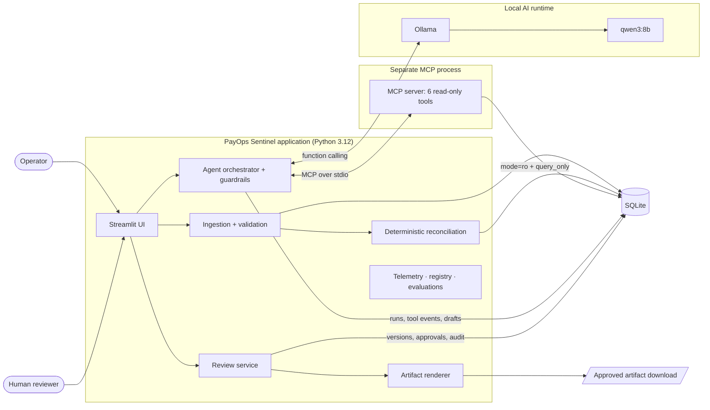

# Architecture

One application · one agent · one MCP server · one SQLite database. Everything runs locally.

## The decision boundary

| Question | Decided by | Where |
|---|---|---|
| What is wrong? (exception, expected amount) | Python, deterministically | `reconciliation/` |
| Why might it be wrong? (evidence, explanation, draft) | Qwen3, through read-only tools | `agent/`, `mcp_server/` |
| May this communication leave the system? | A human reviewer | `review/service.py` |

## Request flow (investigation)

1. The UI or CLI calls `agent.orchestrator.run_investigation(settings, exception_id)`.
2. The host launches `python -m payops_sentinel.mcp_server.server --db … --manifest …` over stdio
   (list arguments, minimal environment) and connects an MCP `Client`.
3. The host lists tools, keeps only the six allowlisted, read-only ones (`check_tool_catalog`), and
   converts their schemas into Ollama function definitions.
4. The host reads ground truth itself (exception details + evidence; recorded as actor `host`).
5. Tool loop (≤ 4 model turns, ≤ 8 calls): Qwen3 proposes calls → the host validates the name and
   arguments (`validate_tool_call`) → MCP executes → the result goes back to the model as data.
6. Drafting: one schema-constrained call (`format=AgentInvestigationDraft` JSON schema, no tools),
   then independent Pydantic validation and ground-truth checks (evidence ownership, evidence
   actually retrieved, `$` amounts and `EMP-` references present in the evidence). Up to 2 attempts.
7. Success → draft v1 `pending_review`, exception `under_investigation`. Any failure → exception
   `manual_review`. Either way, the run, its tool events and an audit event are committed in one
   transaction.

## Module map

| Package | Responsibility | Depends on |
|---|---|---|
| `domain` | Pydantic models, enums, identifier patterns | – |
| `ingestion` | CSV loading, validation, idempotent batch ingestion | domain, storage, reconciliation, review.audit |
| `reconciliation` | Deterministic rules (Decimal, cents, basis points) | domain |
| `storage` | Schema, connections, repositories (all SQL), backup | domain |
| `mcp_server` | MCP v2 `MCPServer` with six read-only tools | storage, operations.registry |
| `agent` | Ollama client, orchestrator, prompts, schemas, guardrails | mcp (client), storage, review.audit |
| `review` | Roles, draft lifecycle, approvals, audit chain, artifacts | storage, agent.schemas |
| `operations` | Telemetry, asset registry, evaluation harness | storage, agent |
| `ui` | Streamlit pages: read via repositories, act via services | all services |

The deterministic layers (`domain`, `ingestion`, `reconciliation`, `storage`) never import
`ollama`, `mcp`, `streamlit`, `agent` or `mcp_server`; a test enforces this.

## Why these choices

- **MCP instead of direct function calls:** a standard, discoverable tool boundary that runs as a
  separate process, can be reused by other MCP hosts and is tested on its own. MCP provides the
  integration standard, not the security: authorisation is enforced by the host allowlist,
  argument validation, the read-only connection and the absence of write tools.
- **Two-stage model use:** Ollama does not reliably combine `tools` and `format` in one call, and
  Qwen3's reasoning mode interferes with both, so tool calling (`think=False`) and the structured
  draft are separate calls.
- **SQLite:** no server to operate. Read-only access is enforced by `mode=ro` + `PRAGMA query_only`.
  Roles are application-level, because SQLite has no database users.
- **No FastAPI, Redis, vector DB or Docker:** none is needed for the stated requirements.
